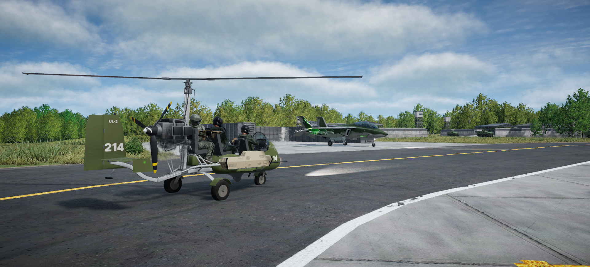
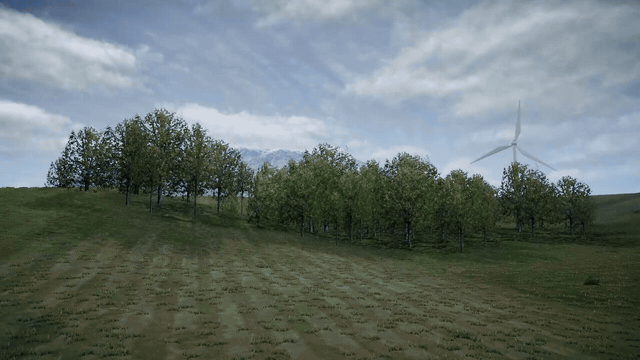
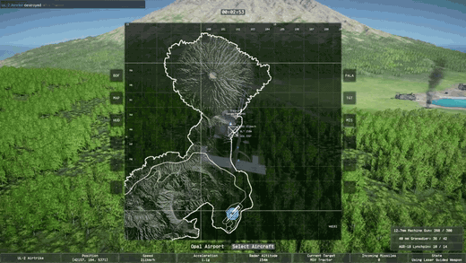

# UL-2 Airtrike

A three-seat armed gyrocopter for **Nuclear Option**, built with Blueprinter.

> A three-seat gyrocopter flown by reserve aviation units. The UL-2 can perform border patrol, armed reconnaissance, and light attack missions, but Reservists are reluctant to fly into enemy airspace against more sophisticated aircraft and air defense systems. A pair of missile racks allow the gyrocopter to engage enemy light armor in close combat. A third seat allows for a dedicated spotter or shooter with multiple weapons options.

## In action

*Airtrike ops (click for the full-quality video)*

*40 mm employment (click for the full-quality video)*

## Features

- **A real gyro flight model.** The rotor is unpowered and autorotates from the airflow, so the UL-2 flies like a slow, draggy aeroplane and cannot hover. A pre-rotator spins the rotor up for the takeoff roll.
- **Three tandem seats.** Pilot, copilot and a third seat that carries a passenger of your choice:
  - **Machine Gunner** with a belt-fed machine gun on an articulated support arm
  - **Grenadier** with a six-shot 40 mm launcher
  - **Spotter** with a large binocular designator, for longer visual identification range
  - **Expedient ECM Pod** strapped into the seat
- **Forward gun:** a fixed 12.7 mm machine gun in a side mount with a small self-aiming arc.
- **Two side stubs** for light stores: AT-145 anti-tank missiles (four per stub), a rocket pod, AGM-48 single or double, an air-to-air missile, or an ECM pod.
- **Nose laser pod** for laser-guided weapons.
- **Analog cockpit** with live gauges (globe attitude indicator, airspeed, altimeter, vertical speed, rotor and engine rpm, fuel) and one MFD.
- **Fixed rough-field gear** for dirt and grass strips.
- **Five liveries:** Reservist Olive, Stainless Steel, Black Tiger, PALA Camel Corps and BDF Orca. The two faction liveries are locked to their factions.
- **Seven AI loadouts:** Standard, Spotter, Tank Hunter, Survivor, Frontliner, Broker and Decoy.
- **Crew bail out** over the side with parachutes; there are no ejection seats.
- Fits the medium hangar.

## Controls

| Input | What it does |
| --- | --- |
| Custom axis 1 | Manual rotor rpm. Moving it switches Auto RPM Management off and the axis keeps the rotor (pre-rotator on the ground, rotor rpm in flight) until you switch Auto RPM Management back on. |
| Flight assist toggle | Auto RPM Management. When on, the rotor rpm is handled for you, including a full spin-up on the takeoff roll at full throttle (ROTOR AUTO on the HUD). |
| Brake | Rotor brake |
| Gear toggle | The gear is fixed and always down. The key still switches the gear state, which arms the weapons. |

The rotor gauge on the HUD shows the set rpm (pointer) and the actual rpm (bar and readout). Wait for the green before you rotate.

## Installation

Requires BepInEx 5 and [Blueprinter](https://github.com/nikkorap/NOBlueprinter-Releases).

Download the UL-2 DLL from the [Releases](../../releases) page and put it in `Nuclear Option\BepInEx\plugins`. The mod is a single file.

## Repository layout

| Folder | Contents |
| --- | --- |
| `plugin/` | The BepInEx plugin (rotor model, gauges, crew animation, AI tweaks) |
| `unity/` | Unity editor script that builds the aircraft prefab |
| `art/scripts/` | Blender scripts that build, unwrap, paint and export the model |
| `docs/media/` | Screenshots and videos |

See `CHANGELOG.txt` for the version history and `LICENSE` for the licence.

## Livery painting

The `Livery Bundle` folder has the complete exterior as an FBX with the in-game texture layout, a blank base, the UV layout, the surface maps and the five shipped liveries. See `Livery Bundle/README.txt`.
