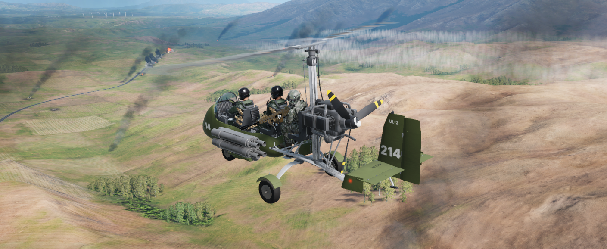
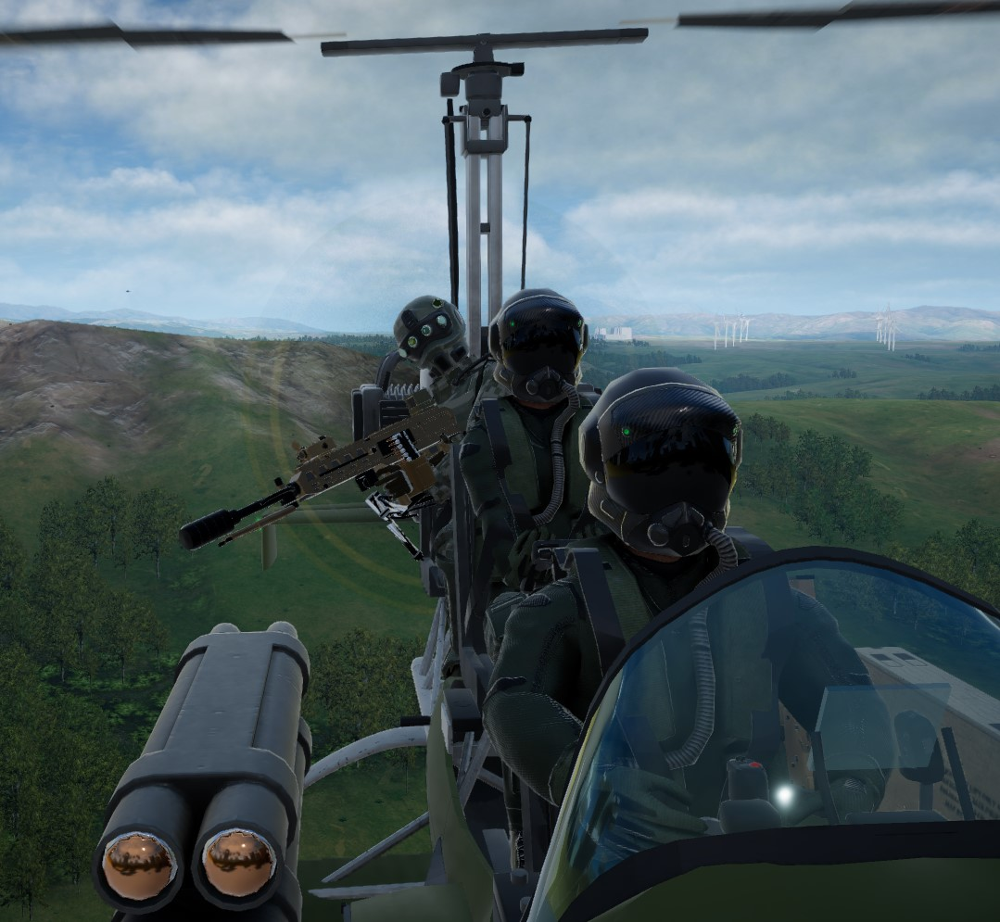

<b>Due to coordinated account report attempts from the nuclear option discord community (they snitch on you when you make it this obvious) this project will no longer be updated. I encourage everyone to enjoy this mod as-is or carry it into the future yourselves. It was an enjoyable time but the coordinated effort to kill my accounts is affecting my more professional efforts. Sorry!</b>

# UL-2 Airtrike

A three-seat armed gyrocopter for **Nuclear Option**!

> A three-seat gyrocopter flown by reserve aviation units. The UL-2 can perform border patrol, armed reconnaissance, and light attack missions, but Reservists are reluctant to fly into enemy airspace against more sophisticated aircraft and air defense systems. A pair of missile racks allow the gyrocopter to engage enemy light armor in close combat. A third seat allows for a dedicated spotter or shooter with multiple weapons options.

## In action

## Features

- **A real gyro flight model.** The rotor is unpowered and autorotates from the airflow, so the UL-2 flies like a slow, draggy aeroplane and cannot hover. A pre-rotator can use the engine to increasw the rotor speeds for advanced maneuvers, which can be managed by flight assist or with custom axis 1. The wheelbrake button also engages a rotor brake.
- **Three tandem seats.** Pilot, copilot and a third seat that carries a passenger of your choice:
  - **Machine Gunner** with a belt-fed machine gun.
  - **Grenadier** with a six-shot 40 mm launcher
  - **Spotter** with binoculars, for longer visual identification range

- **Forward gun:** a fixed 12.7 mm machine gun in a side mount with some aim correction.
- **Stub Pylons** AT-145 anti-tank missiles (four per stub), lynchpins, AGM-48 single or double, an air-to-air missile, or an ECM pod.
- **Analog cockpit** with live gauges and a primary MFD.
- **Grass takeoff and landing** for forward resupply
- **Five liveries:** Reservist Olive, Stainless Steel, Black Tiger, PALA Camel Corps, and BDF Orca.
- **Two included missions:** a reservist gunnery range "tutorial" mission and a variant of Altercation with a lot of gyrocopters in their natural habitat.

## Controls

| Input | Functionality |
| --- | --- |
| Custom axis 1 | Manual rotor rpm. Moving it switches Auto RPM Management off and the axis keeps the rotor (pre-rotator on the ground, rotor rpm in flight) until you switch Auto RPM Management back on. |
| Brake | Rotor brake |
| Gear toggle | The gear is fixed and always down. The key still switches the gear state, which arms the weapons. |

The rotor gauge on the HUD shows the set rpm and the actual rpm

## Installation

Requires BepInEx 5 and [Blueprinter](https://github.com/nikkorap/NOBlueprinter-Releases).

Download the UL-2 DLL from the [Releases](../../releases) page and put it in `Nuclear Option\BepInEx\plugins`.

See `CHANGELOG.txt` for the version history.

Claude helped extensively with plugin code and part of the model.

## Livery painting

The `Livery Bundle` folder has the complete exterior as an FBX with the in-game texture layout, a blank base, the UV layout, the surface maps and the five shipped liveries. See `Livery Bundle/README.txt`.
